# AI 购物助手

> [English](./README_EN.md)

AI 购物助手是一个面向学习与项目演示的多模态购物决策 Agent。用户可以通过文字或图片描述购物需求，系统会解析预算、品牌、品类和排除条件，从固定商品目录中检索候选商品，并完成推荐、追问、对比、详情查询、加购和下单确认。

项目重点不是模拟完整电商平台，而是展示一条可运行、可测试的 Agent 业务链路：**需求理解 → 商品检索 → 工具调用 → 多轮决策 → 客户端交互**。

## 界面展示

界面采用「小票 + 价签」风格：热敏纸白底、小票墨色和价签黄，价格、合计与订单号使用等宽字体；品牌图标、取景框和品类插画均为项目自绘素材。以下均为实际运行截图，商品与价格来自本地演示目录，对话由离线演示模型生成。

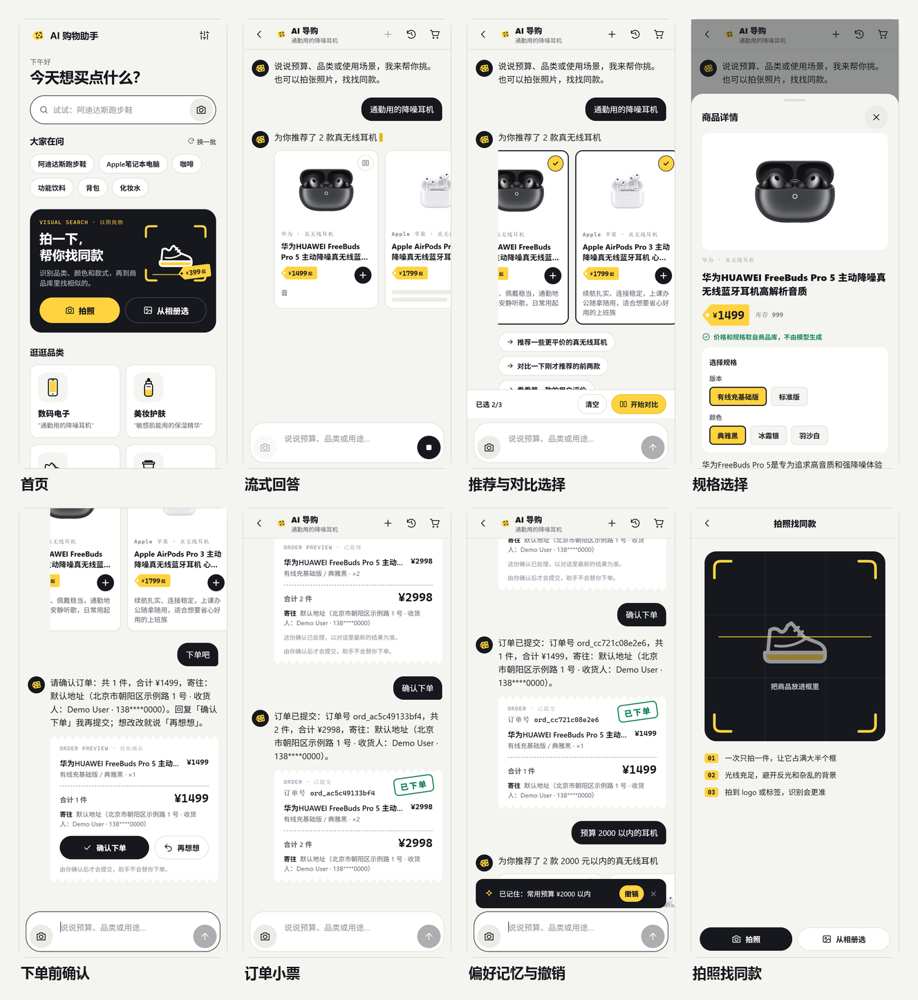

**桌面端首页与对话**

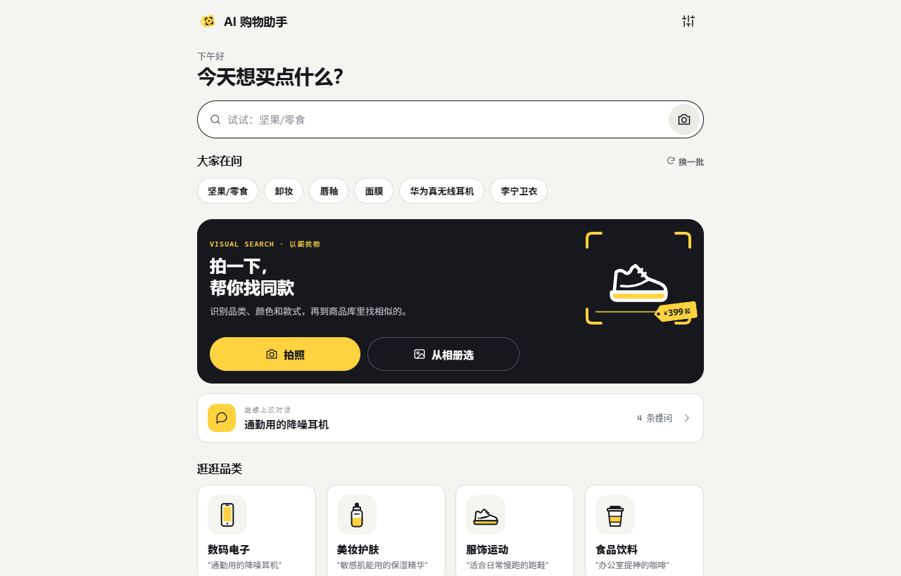

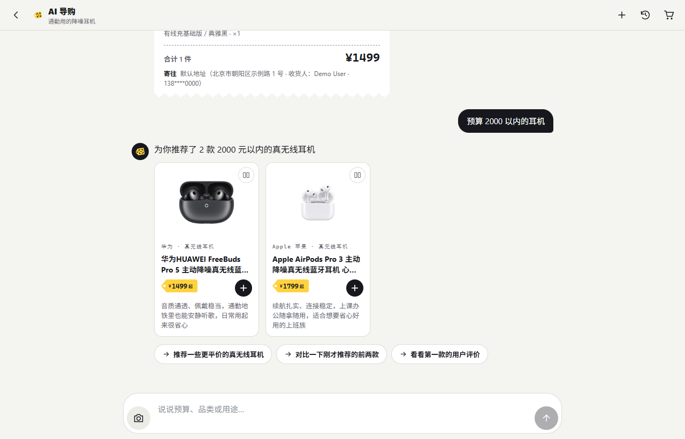

**移动端细节**

| 流式回答 | 推荐与对比选择 | 商品对比 |
| :---: | :---: | :---: |
| 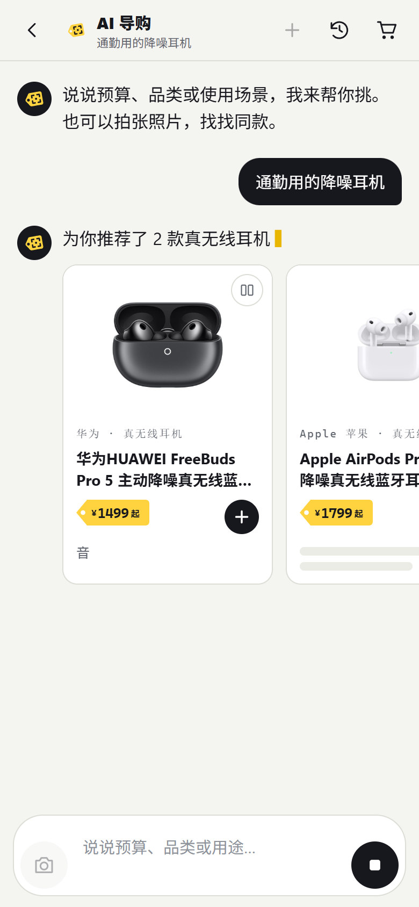 | 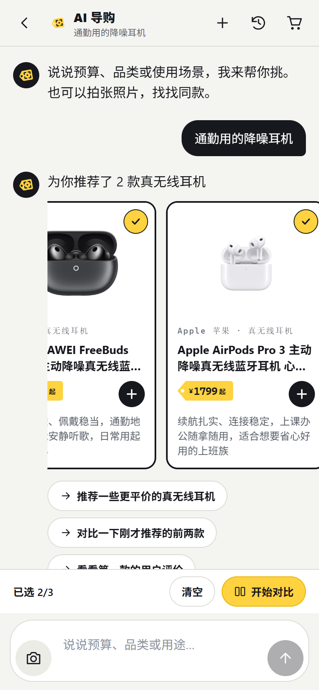 | 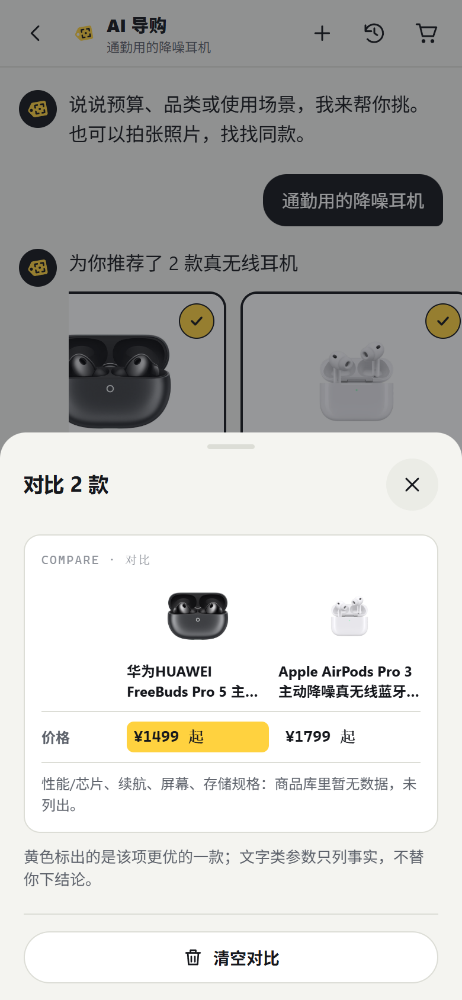 |
| **规格选择** | **下单前确认** | **订单小票** |
| 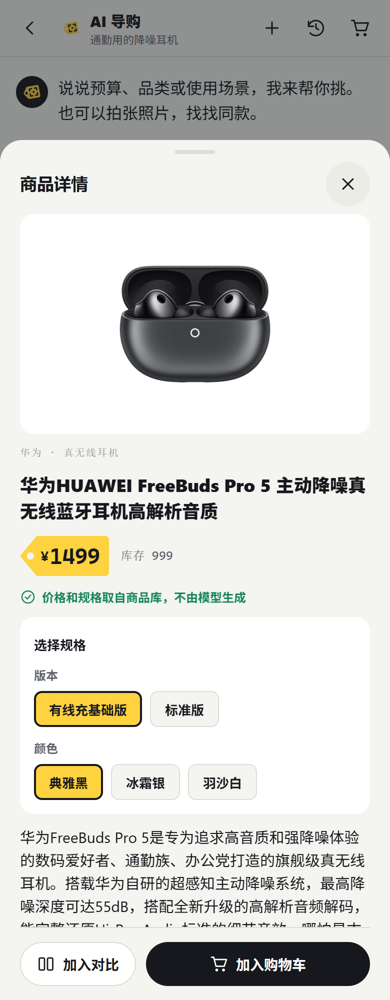 | 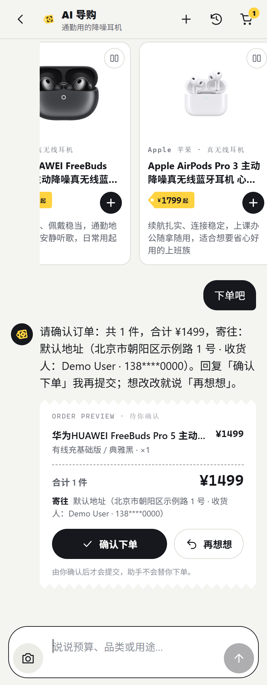 | 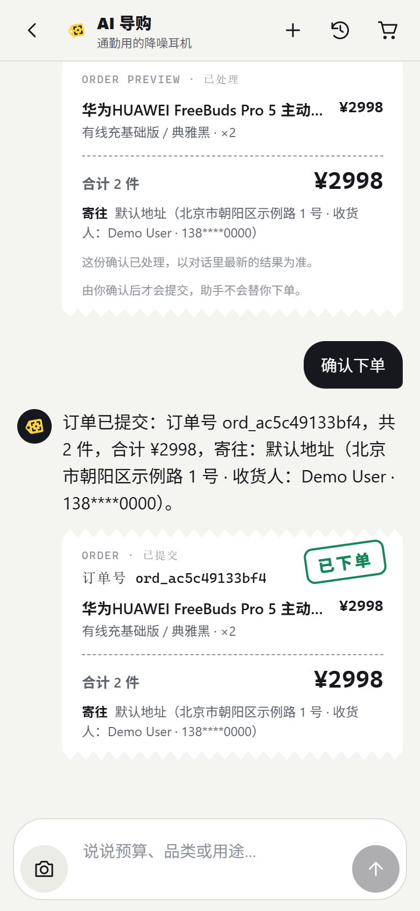 |
| **偏好记忆与撤销** | **我的偏好** | **拍照找同款** |
| 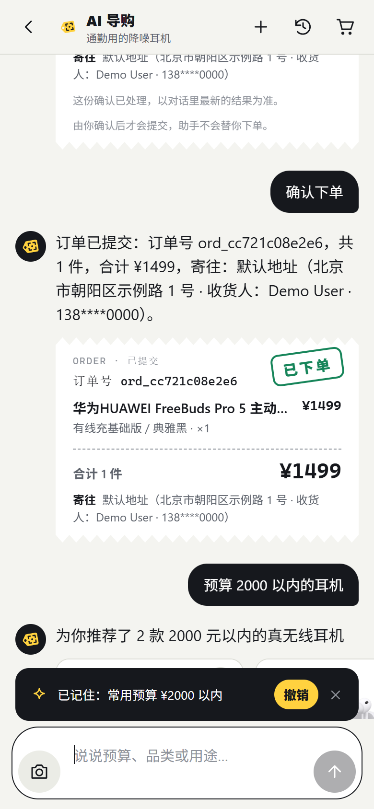 | 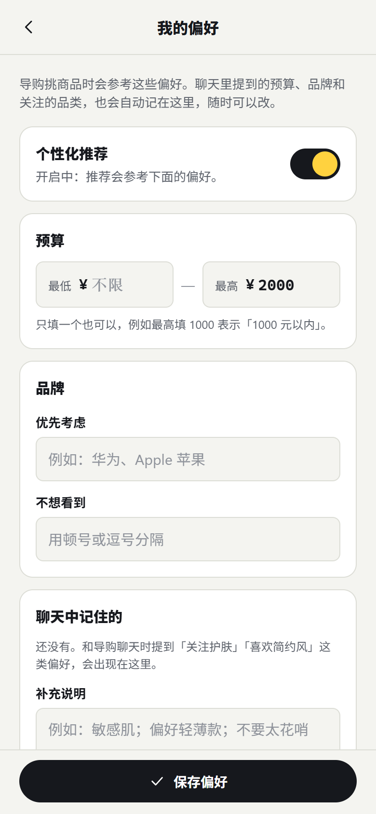 | 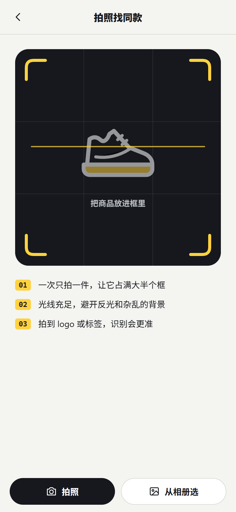 |

## 项目定位

本项目用于学习和展示垂直领域 Agent 的工程实现，主要关注以下问题：

- 如何将自然语言和图片输入转换为结构化购物条件；
- 如何在多轮对话中持续合并预算、品牌和排除条件；
- 如何让 Agent 根据用户意图选择检索、详情、对比或购物车工具；
- 如何将模型输出与数据库中的商品事实分离，避免由模型生成价格等关键字段；
- 如何让有副作用的操作（加购、下单）在重试、断网和模型误判时依然安全；
- 如何在没有模型密钥时保留可运行、可测试的本地链路。

仓库内包含 100 条固定演示商品数据，适合本地开发、功能演示和自动化测试。项目不接入京东、淘宝等实时平台，也不提供实时库存、全网比价或支付能力。

## 核心功能

| 功能 | 说明 |
| --- | --- |
| 文本推荐 | 根据品类、预算、品牌、属性和排除条件检索商品 |
| 图片输入 | 校验并解析 JPEG、PNG、WebP 图片，将识别结果接入推荐流程；Web 端上传前自动压缩为 JPEG |
| 多轮筛选 | 在同一会话中追加或修改预算、品牌、属性及负向条件 |
| 智能追问 | 需求信息不足时返回澄清问题，而不是直接给出不可靠推荐 |
| 流式回答 | 回答逐 token 推送，客户端边生成边渲染开场白和每件商品的推荐理由（Web 与原生端均支持） |
| 商品详情与规格 | 查询商品与 SKU 的结构化信息；规格选择器默认选中最便宜的有货规格，缺货或不存在的组合置灰 |
| 商品对比 | 对 2～3 件商品进行字段化比较，价格更优项高亮 |
| 购物车 | 支持加入、删除、修改数量和查看购物车 |
| 下单确认 | 模型只能生成订单预览，用户确认后才会提交；购物车变化或预览过期需重新确认 |
| 请求幂等 | 对话与购物车请求携带 `request_id`，重试回放已有结果，不会重复加购或下单 |
| 用户偏好 | 保存跨会话的品牌、预算和属性偏好；自动记住时提示并可一键撤销 |
| 安全降级 | 模型或向量检索不可用时，回退到规则路由和关键词检索 |
| 离线演示 | 内置规则演示模型，无需 API Key 即可跑通完整链路 |

## 关键设计

**流式输出与幂等重试**

- 回答生成阶段逐 token 转发模型输出，`done` 事件中的完整回答为最终结果；输出被截断时回退为兜底文案并在 trace 中标记。耗时分别记录首字时间与总耗时。
- 客户端用容错解析器读取尚未写完的 JSON，开场白和推荐理由随生成逐字出现，后续建议在回答完整后才显示，避免闪烁。
- `/chat`、`/chat/stream`、`/cart/mutate` 接受 `request_id`，由请求账本记录处理中 / 完成 / 冲突状态。共享模式会绑定请求参数，重复请求回放结果，不同参数返回 409；购物车变更与结果记录在同一 PostgreSQL 事务提交。聊天发生副作用结果不确定的崩溃时保留 pending，需核对后处理，不自动接管。
- 流式连接中断时，客户端以同一 `request_id` 改走 `/chat` 重试：已执行的回合直接回放，不会重复执行加购或下单。

**人工确认下单（Human-in-the-loop）**

- 模型选择「下单」时只会得到订单预览，预览附带确认令牌、购物车指纹和 10 分钟有效期。
- 用户的下一句回复由确定性规则判断（如「确认下单」「再想想」），不经过 LLM 路由，避免把「确认一下运费」误判为同意。
- 确认时购物车内容变化或预览过期，会按最新购物车重新生成预览；用户转而说其他事情时，预览自动撤回。

**可信的商品事实**

- 标题、品牌、价格和 SKU 均从商品数据库回填，模型只负责理解、路由和表达；详情页明确标注「价格和规格取自商品库」。
- 下单确认、订单号和合计等关键文本由代码生成，不交给模型改写。

## 技术栈

| 模块 | 技术与职责 |
| --- | --- |
| 移动端 | React Native、Expo、TypeScript、React Navigation、react-native-svg |
| API | FastAPI，提供对话、SSE、商品、对比、购物车和偏好接口 |
| Agent | Orchestrator、Intent Router 和领域工具集合 |
| 模型层 | 统一 `ChatModel` 接口、豆包 Ark Adapter、离线演示模型、测试用 Fake Adapter |
| 检索 | 默认关键词检索；共享模式使用 pgvector，离线兼容模式可使用 Chroma；可选 Rerank |
| 数据存储 | PostgreSQL 保存商品、购物车、偏好、会话检查点和请求账本；Redis 保存热会话、缓存和并发租约；SQLite 保留离线演示兼容 |
| 部署 | Docker、Docker Compose |
| 测试 | Pytest、Vitest、TypeScript 类型检查 |

## 系统架构

设置 `DATABASE_URL` 与 `REDIS_URL` 可启用共享部署：多个 API 进程共用 PostgreSQL + Redis，无需会话粘滞。包含版本化缓存、同会话并发控制、数据库 fencing、连接池上限和聊天容量保护。迁移、启动、回滚及测试命令见 [共享部署说明](docs/postgres-redis.md)，实施范围见 [迁移计划](docs/postgres-redis-plan.md)。未配置共享存储时继续使用原离线模式。

[实际验证报告](docs/postgres-redis-verification.md)记录了 458 项后端测试通过及双进程持续负载结果，并保留压测发现问题的失败记录。压测使用离线模型，不能作为真实模型准确率或生产容量依据。

```text
React Native / Expo（Web · iOS · Android）
        │  request_id · SSE 流式事件
        ▼
FastAPI API（/chat, /chat/stream, /cart/mutate）
        │                      │
        ▼                      ▼
Agent Orchestrator      Request Ledger（幂等回放）
        │
        ├─ 待确认订单 → 规则判定回复（不经过 LLM）
        ▼
Intent Router → Tools（Search / Detail / Compare / Cart）
        │                         │
        ▼                         ▼
ChatModel Adapter          PostgreSQL + pgvector / SQLite
（豆包 / 离线演示 / Fake）     （商品 · SKU · 购物车 · 请求账本）
                                  │
                           Redis 热会话、缓存与并发控制
```

架构遵循三个基本原则：

1. SQLite 是商品标题、品牌、价格和 SKU 信息的事实来源，模型只负责理解、路由和表达。
2. 有副作用的操作（加购、下单）由确定性代码执行，下单必须经过用户确认，请求可安全重试。
3. 模型与检索能力均可替换或降级，外部服务不可用时不会阻止基础商品检索和自动化测试。

更详细的模块说明见 [架构文档](./docs/architecture.md)，接口字段与事件格式见 [API 文档](./docs/api.md)。

## 工作流程

一次典型购物请求会经过以下步骤：

1. 用户在客户端输入文字，或选择一张商品相关图片；客户端为请求生成 `request_id`。
2. API 登记请求账本，创建或恢复会话，并对图片类型、大小和来源进行安全校验。
3. 若有待确认的订单，用户回复由规则直接判定；否则由 Intent Router 判断意图属于推荐、继续筛选、详情、对比、购物车或澄清。
4. 查询理解模块提取品类、预算、品牌、属性和排除条件，并与会话上下文及用户偏好合并。
5. Search Service 使用默认关键词模式，或可选的 Hybrid 模式召回候选商品。
6. Agent 调用对应领域工具，并从 SQLite 回填可信商品字段。
7. API 通过 SSE 推送状态、工具结果和回答片段；客户端将商品、对比、规格选择和订单渲染为可交互卡片。

## 项目结构

```text
.
├─ backend/
│  ├─ agent/          # Agent 编排、意图路由、工具和回答生成
│  ├─ api/            # 对话、SSE、商品、对比、购物车和偏好接口
│  ├─ llm/            # 模型抽象、豆包 Adapter、离线演示模型和测试 Adapter
│  ├─ search/         # 查询理解、关键词检索和过滤
│  ├─ rag/            # Chroma、向量检索和重排序
│  ├─ store/          # 商品、会话、偏好、购物车和请求账本存储
│  ├─ scripts/        # 离线演示后端等辅助脚本
│  ├─ eval/           # 路由、检索和一致性评测
│  ├─ db/             # SQLite 初始化脚本
│  └─ Dockerfile
├─ mobile/            # React Native / Expo 客户端与品牌素材
├─ data/              # 100 条演示商品 JSON 数据
├─ docs/              # 架构、API、项目定位、截图和验收记录
└─ docker-compose.yml
```

商品图片二进制文件已被 Git 忽略，不会随仓库克隆下载；仓库仅保留商品图片 URL 清单，图片展示依赖清单所指向的外部存储。

## 快速开始

### 环境要求

- Python 3.11 或更高版本
- Node.js 20 或更高版本
- npm
- （可选）Docker Desktop

以下命令均从仓库根目录执行，示例环境为 Windows PowerShell。

### 1. 启动后端

```powershell
py -3.11 -m venv .venv
.\.venv\Scripts\python.exe -m pip install -r .\backend\requirements.txt
Copy-Item .\backend\.env.example .\.env

Set-Location .\backend
..\.venv\Scripts\python.exe -m store.import_product_data --reset
..\.venv\Scripts\python.exe -m store.import_image_manifest
..\.venv\Scripts\python.exe -m uvicorn main:app --host 127.0.0.1 --port 8000
```

启动后可访问：

- 健康检查：`http://127.0.0.1:8000/health`
- Swagger：`http://127.0.0.1:8000/docs`

#### 没有模型密钥：离线演示后端

```powershell
.\.venv\Scripts\python.exe .\backend\scripts\run_demo_server.py
```

演示后端使用规则演示模型，不读取任何已保存的密钥，适合前端联调和功能演示；它只模仿各环节的响应格式，不代表真实模型的理解与表达能力。`DEMO_STREAM_DELAY_MS` 可调整流式输出速度。

#### 或者：用 Docker 启动后端

需要 Docker Desktop。镜像构建时会从 `data/` 重建商品库；购物车、订单和偏好保存在 Docker 数据卷里，重启容器不会丢失，也不会改动本机的 `backend/storage`。

```powershell
# 真实模型：密钥来自可选的 .env，或设置页写入的 .local/（以挂载方式提供，不会打进镜像）
docker compose up -d --build backend

# 离线演示模型：不需要 API Key，数据卷与真实环境分开
docker compose --profile demo up -d --build backend-demo

docker compose ps                        # 查看状态（healthy 即就绪）
docker compose logs -f backend           # 查看日志
docker compose --profile demo down       # 停止（保留数据卷；加 -v 会清空购物车等数据）
```

两个服务都占用本机 8000 端口，同一时间只运行一个；用 `$env:BACKEND_PORT="8010"` 可换端口。无法访问 Docker Hub 时，compose 默认从 `mirror.gcr.io` 拉取同一个 Python 基础镜像；PyPI 较慢时可设置 `$env:PIP_INDEX_URL="https://pypi.tuna.tsinghua.edu.cn/simple"` 后再构建。

### 2. 启动客户端

另开一个 PowerShell 窗口，在仓库根目录执行：

```powershell
Set-Location .\mobile
npm install
$env:EXPO_PUBLIC_API_URL="http://127.0.0.1:8000"
npm start            # 按 w 打开 Web 版，或直接运行 npx expo start --web
```

不同运行环境的后端地址：

| 环境 | API 地址 |
| --- | --- |
| Web / iOS 模拟器 | `http://127.0.0.1:8000` |
| Android 模拟器 | `http://10.0.2.2:8000` |
| 真机 | `http://<电脑局域网地址>:8000` |

真机调试时需要让后端监听 `0.0.0.0`，并确保手机能够访问电脑所在局域网。API 密钥保存在后端本机，不要写入移动端环境变量。

## 配置说明

模型可以直接通过首页右上角「服务设置」配置，无需创建 `.env`：

1. 选择「豆包 / 火山方舟」或「OpenAI 兼容」。
2. 填写同一服务对应的 **Base URL、模型 ID、API Key**。Base URL 不要带 `/chat/completions`；套餐用户须使用套餐控制台提供的地址和模型，页面默认值只是普通 API 示例。
3. 点击「测试连接」检查当前填写的参数，再点击「保存配置」。测试本身不会保存，且只验证简单文本回复，不代表图片与工具调用均可用。
4. 返回导购开启新对话。保存后下一次请求使用新配置，无需重启；后端重启后也会恢复。

配置保存在根目录 `.local/model-config.json`（已被 Git 忽略）。配置查询不会返回密钥，浏览器也不再保存新密钥。仅修改模型 ID 时可留空 Key 保留原值；更换供应商或 Base URL 时需重新填写 Key。此设置接口面向本机单进程演示使用。

没有保存页面配置时，仍可复制 `backend/.env.example` 到根目录 `.env`，通过以下环境变量配置。页面保存的模型配置优先于环境变量：

| 配置 | 默认值 | 说明 |
| --- | --- | --- |
| `CHAT_PROVIDER` | `doubao` | 聊天模型供应商 |
| `CHAT_API_KEY` | 空 | 模型访问密钥 |
| `CHAT_BASE_URL` | 空 | 模型服务地址 |
| `CHAT_MODEL` | 空 | 模型或推理接入点 ID |
| `RETRIEVAL_MODE` | `lexical` | `lexical` 或 `hybrid` |
| `USE_RERANK` | `0` | 是否启用重排序 |
| `CHAT_IMAGE_ALLOWED_HOSTS` | 空 | 允许下载远程图片的域名列表；为空时仅接收上传图片 |

默认 `lexical` 模式不依赖 Embedding、Chroma 或 Rerank 服务。启用 `hybrid` 时，还需要配置 `EMBEDDING_*` 并建立非空 Chroma collection；启用 Rerank 时需要配置 `RERANK_*`。

商品对比中的参数维度（续航、屏幕等）来自预先生成的对比索引，需要配置好模型后在 `backend` 目录运行 `python -m rag.build_compare_index`；未生成索引时对比只列出价格，其余维度会注明暂无数据。

豆包 Ark 的模型 ID、Base URL 和可用能力由使用者自己的部署决定，仓库不会预设真实凭据。

## 测试与验证

已完成真实火山 Agent Plan 本地验收，保留原始请求响应、链路耗时、商品事实核验和未通过项。最新结果见 [2026-09-16 真实模型验收报告](docs/validation/2026-09-16/REPORT.md)，前端截图见 [2026-09-13 验收记录](docs/validation/2026-09-13/REPORT.md)。这些都是小样本开发验收，不代表生产准确率或已上线运营。

运行后端测试：

```powershell
Set-Location .\backend
..\.venv\Scripts\python.exe -m pytest -q
```

运行客户端测试和类型检查：

```powershell
Set-Location .\mobile
npm test
npx tsc --noEmit
```

建议手工验证以下场景：

1. 输入“推荐一款 500 元以内、不要含酒精的防晒”，观察回答逐字生成、商品卡片先出现。
2. 继续输入“预算改成 300 元，并排除某品牌”。
3. 打开商品详情选择规格，再勾选 2～3 件商品进行对比。
4. 将商品加入购物车，说“下单吧”，确认出现订单预览而不是直接下单；回复“确认下单”后生成订单小票。
5. 上传一张小于 5 MB 的 JPEG、PNG 或 WebP 图片。
6. 断开网络后发送消息，确认客户端显示可重试错误；恢复网络后点「重试」，确认不会重复执行购物车操作。

## 项目边界

当前项目已经覆盖本地演示所需的主要链路，但仍有明确边界：

- 商品数据来自固定演示目录，不代表实时价格、库存或平台可购买状态；
- 商品图片二进制未随 Git 仓库分发，现有图片 URL 的可用性取决于外部存储；
- Hybrid 检索、Rerank、对比索引和真实豆包调用需要有效的外部服务配置；
- 下单只生成本地演示订单，不涉及支付、物流和售后；尚未实现真实平台采集与跨平台 SKU 对齐；
- 离线演示模型只模仿响应格式，不能用来评估真实模型效果；
- 尚未实现正式用户认证、多租户隔离和完整可观测性；Docker 配置面向本机演示，未做生产加固。

## 相关文档

- [系统架构](./docs/architecture.md)
- [API 说明](./docs/api.md)
- [项目定位](./docs/project-positioning.md)
- [项目状态与后续计划](./docs/project_status_and_next_steps.md)
- [真实商品数据接入方案](./docs/real_data_integration_plan.md)
