# AI Shopping Assistant

> [中文版本](./README.md)

AI Shopping Assistant is a multimodal shopping-decision agent built for learning and demonstration. Users describe what they want in text or with a photo; the system extracts budget, brand, category and exclusions, retrieves candidates from a fixed product catalog, and handles recommendations, clarifying questions, comparison, product details, cart operations and checkout confirmation.

The goal is not to clone an e-commerce platform but to show a runnable, testable agent pipeline: **understand the need → retrieve products → call tools → decide over multiple turns → interact in the client**.

## Interface preview

The interface uses a "receipt + shelf tag" style: thermal-paper white, receipt ink and price-tag yellow, with prices, totals and order numbers in a monospaced font. The app icon, viewfinder and category illustrations were drawn for this project. All screenshots come from the running app; products and prices are demo data and the replies come from the offline demo model.

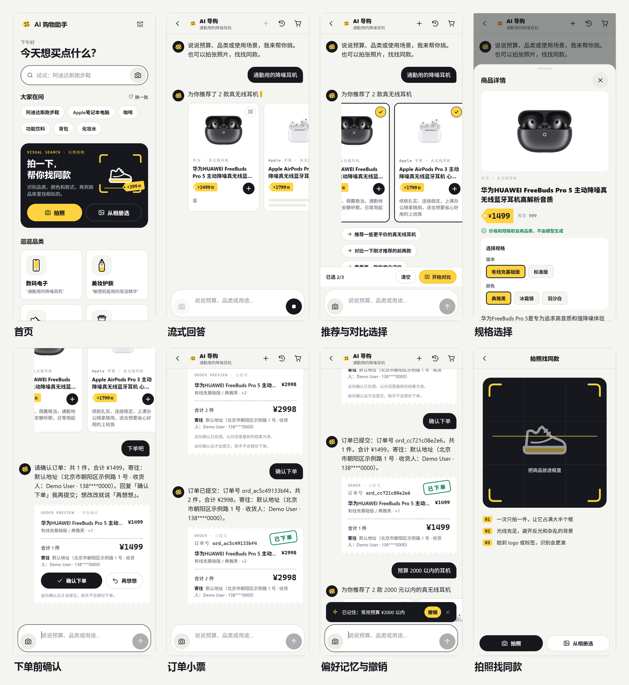

**Desktop**

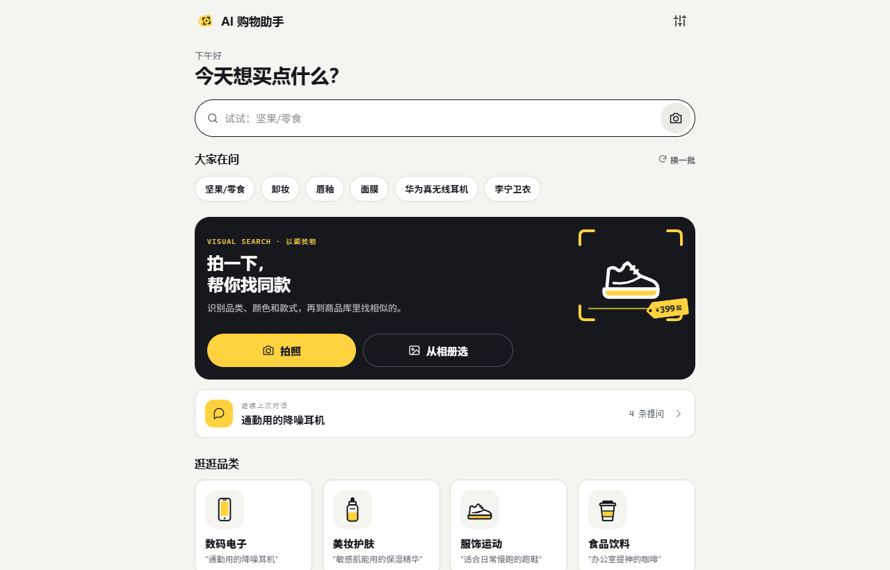

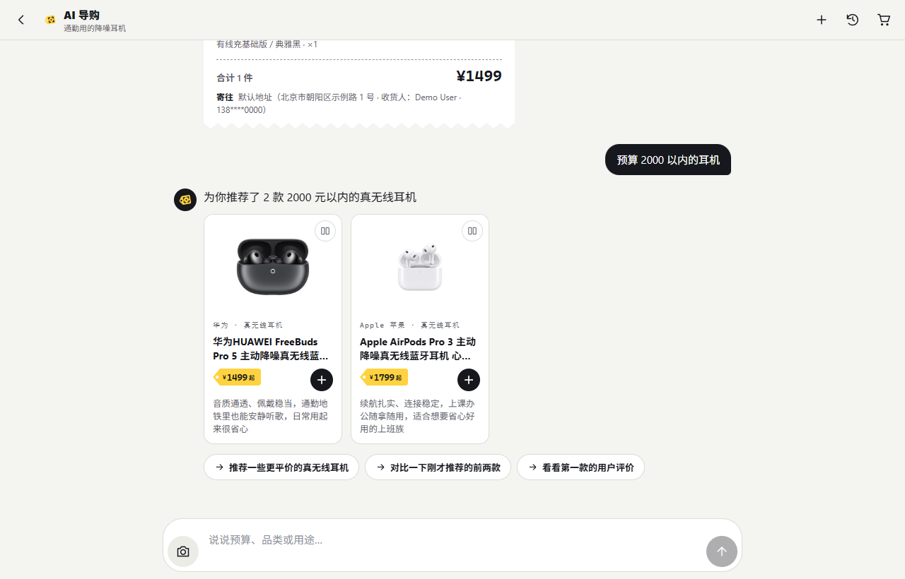

**Mobile details**

| Streaming answer | Recommendations & compare | Comparison |
| :---: | :---: | :---: |
| 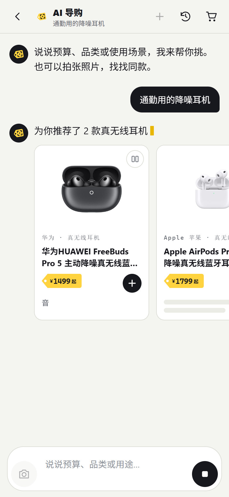 | 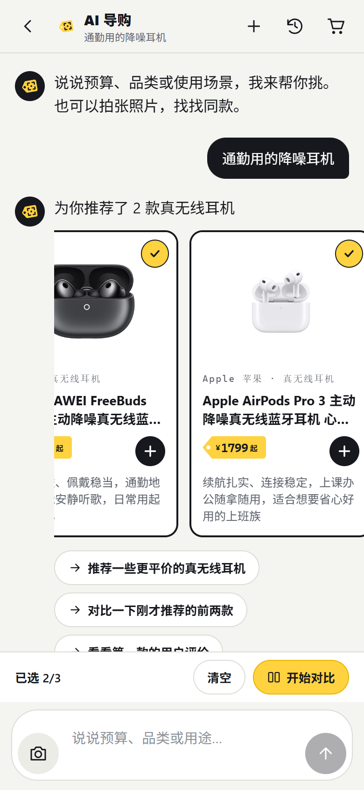 | 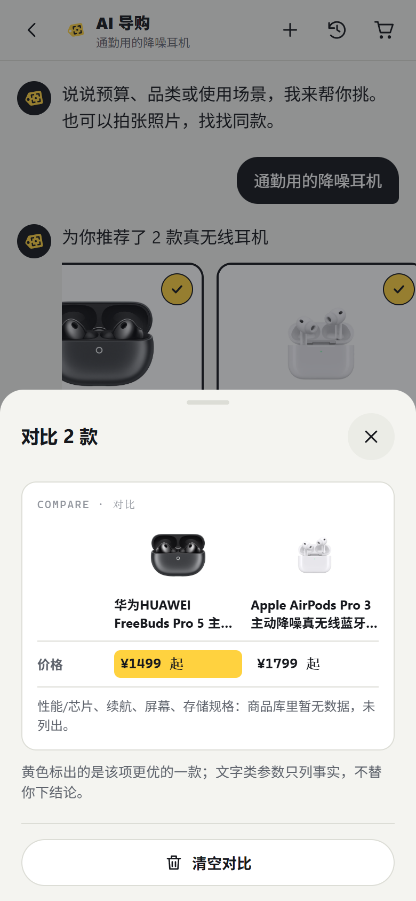 |
| **Spec picker** | **Checkout confirmation** | **Order receipt** |
| 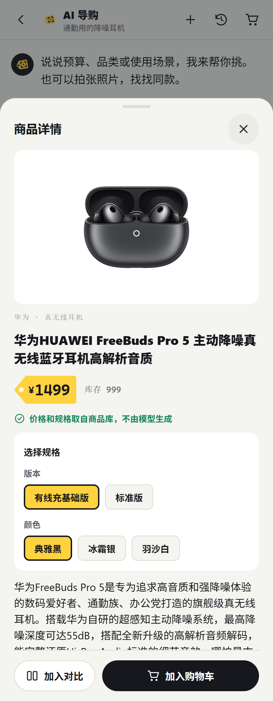 | 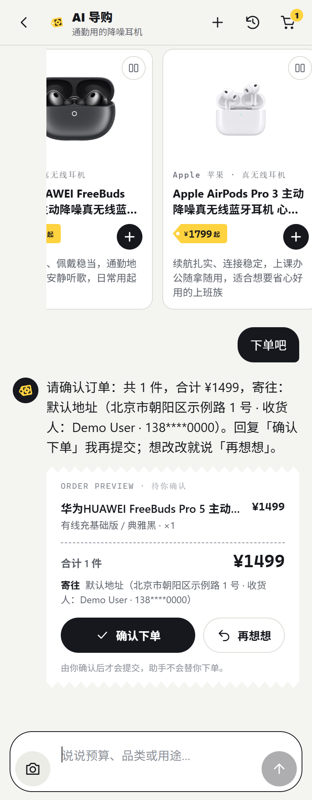 | 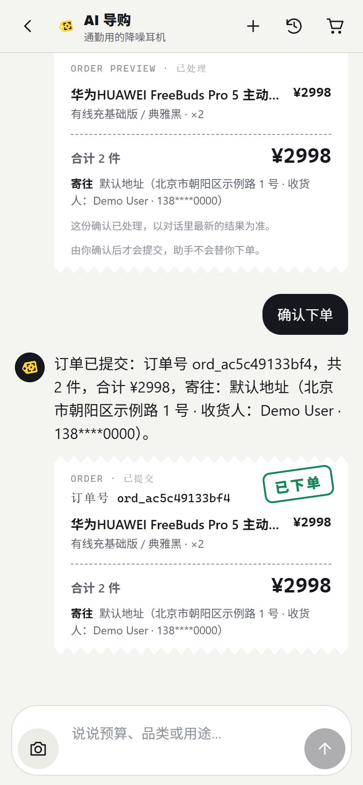 |
| **Preference memory & undo** | **Preferences** | **Photo search** |
| 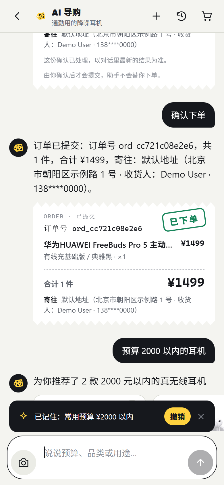 | 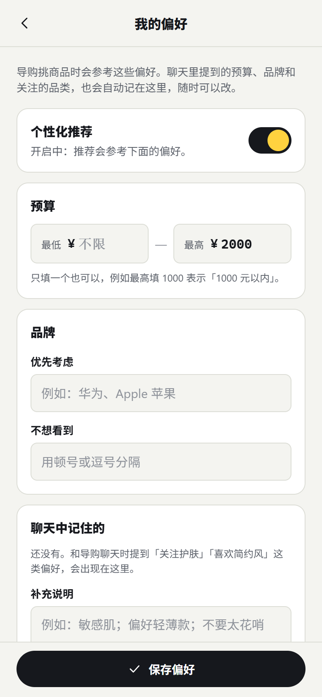 | 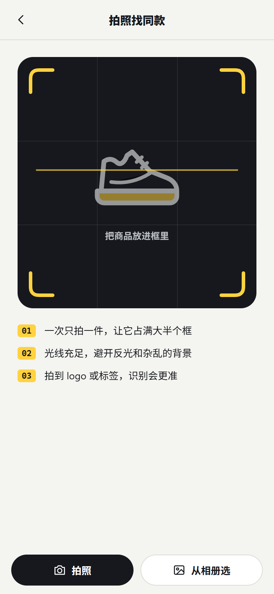 |

## Features

| Feature | Description |
| --- | --- |
| Text recommendations | Retrieve by category, budget, brand, attributes and exclusions |
| Image input | Validate JPEG / PNG / WebP and feed the recognized product into search; the web client compresses uploads to JPEG |
| Multi-turn refinement | Add or change budget, brands, attributes and negative conditions in the same conversation |
| Clarifying questions | Ask when the request is underspecified instead of guessing |
| Streaming answers | Tokens are pushed as they are generated; the client renders the opening and each product's reason while they are written (web and native) |
| Details & SKU picker | Structured product and SKU data; the cheapest in-stock spec is preselected, sold-out or missing combinations are greyed out |
| Comparison | Field-by-field comparison of 2–3 products with the better price highlighted |
| Cart | Add, remove, change quantity and view the cart |
| Checkout confirmation | The model can only create an order preview; the order is placed after the user confirms |
| Idempotent requests | Chat and cart requests carry a `request_id`; a retry replays the stored result instead of adding or ordering twice |
| Preferences | Cross-session brand, budget and attribute preferences; automatic memories are announced and can be undone |
| Graceful degradation | Falls back to rule routing and keyword search when the model or vector search is unavailable |
| Offline demo | A rule-based demo model runs the whole pipeline without an API key |

## Key design decisions

**Streaming and idempotent retries**

- The composer forwards model tokens as they arrive; the full answer in the `done` event is authoritative, and a truncated answer falls back to safe copy flagged in the trace. First-token time and total time are recorded separately.
- The client parses incomplete JSON tolerantly, so the opening and product reasons appear word by word; follow-up suggestions appear only once the answer is complete.
- `/chat`, `/chat/stream` and `/cart/mutate` accept a `request_id`. A SQLite request ledger tracks pending / done / conflict: a repeat replays the stored result (stream replays carry `replayed: true`), a duplicate still running gets 409, and the same id with a different body gets 409. Requests pending for over 120 s can be taken over; records are kept for 24 hours.
- If a stream drops, the client retries through `/chat` with the same `request_id`, so a turn that already ran is replayed rather than executed again.

**Human-in-the-loop checkout**

- When the model chooses "checkout", it only produces an order preview with a confirmation token, a cart fingerprint and a 10-minute expiry.
- The user's next reply ("确认下单", "再想想", …) is classified by deterministic rules that bypass the LLM router, so a question like "确认一下运费" is never taken as consent.
- If the cart changed or the preview expired, a fresh preview is generated; any unrelated message withdraws the preview.

**Trustworthy product facts**

- Titles, brands, prices and SKUs are filled from SQLite; the model only understands, routes and phrases.
- Order confirmations, order numbers and totals are generated by code, not rewritten by the model.

## Tech stack

| Area | Technology and role |
| --- | --- |
| Client | React Native, Expo, TypeScript, React Navigation, react-native-svg |
| API | FastAPI: chat, SSE, products, comparison, cart and preferences |
| Agent | Orchestrator, intent router and domain tools |
| Models | Unified `ChatModel` interface: Doubao Ark adapter, offline demo model, fake adapter for tests |
| Retrieval | Keyword search by default; optional Chroma vector search and rerank |
| Storage | SQLite for product facts, sessions, preferences, cart, orders and the request ledger |
| Deployment | Docker, Docker Compose |
| Tests | Pytest, Vitest, TypeScript type checking |

## Architecture

```text
React Native / Expo (Web · iOS · Android)
        │  request_id · SSE events
        ▼
FastAPI API (/chat, /chat/stream, /cart/mutate)
        │                      │
        ▼                      ▼
Agent Orchestrator      Request Ledger (idempotent replay)
        │
        ├─ pending order → reply classified by rules (no LLM)
        ▼
Intent Router → Tools (Search / Detail / Compare / Cart)
        │                         │
        ▼                         ▼
ChatModel Adapter          SQLite Product Facts
(Doubao / demo / fake)     (products · SKUs · cart · orders)
```

See the [architecture notes](./docs/architecture.md) and the [API reference](./docs/api.md) (Chinese) for details.

## Quick start

Requirements: Python 3.11+, Node.js 20+, npm, and optionally Docker Desktop. Commands run from the repository root in Windows PowerShell.

### 1. Backend

```powershell
py -3.11 -m venv .venv
.\.venv\Scripts\python.exe -m pip install -r .\backend\requirements.txt
Copy-Item .\backend\.env.example .\.env

Set-Location .\backend
..\.venv\Scripts\python.exe -m store.import_product_data --reset
..\.venv\Scripts\python.exe -m store.import_image_manifest
..\.venv\Scripts\python.exe -m uvicorn main:app --host 127.0.0.1 --port 8000
```

Health check: `http://127.0.0.1:8000/health` · Swagger: `http://127.0.0.1:8000/docs`

**No API key?** Run the offline demo backend. It never reads saved credentials and only imitates response shapes, so it is for demos and frontend work, not for judging model quality:

```powershell
.\.venv\Scripts\python.exe .\backend\scripts\run_demo_server.py
```

**Docker** (the image rebuilds the product database from `data/`; cart, orders and preferences live in named volumes; credentials are mounted at runtime, never baked in):

```powershell
docker compose up -d --build backend                       # real model
docker compose --profile demo up -d --build backend-demo   # offline demo model
docker compose --profile demo down                         # stop, keep volumes
```

Both services use port 8000, so run one at a time (`$env:BACKEND_PORT="8010"` changes it). Without Docker Hub access the base image comes from `mirror.gcr.io`; set `PIP_INDEX_URL` for a closer PyPI mirror.

### 2. Client

```powershell
Set-Location .\mobile
npm install
$env:EXPO_PUBLIC_API_URL="http://127.0.0.1:8000"
npm start            # press w for the web build
```

Use `http://10.0.2.2:8000` on the Android emulator and your computer's LAN address on a physical device (with the backend listening on `0.0.0.0`).

## Configuration

Configure the model from **Settings** on the home screen: choose Doubao (Volcano Ark) or an OpenAI-compatible service, enter the Base URL, model ID and API key, test the connection and save. The configuration is stored in `.local/model-config.json` (git-ignored) and takes effect without a restart; the key is never returned by the API. Environment variables from `backend/.env.example` (`CHAT_API_KEY`, `CHAT_BASE_URL`, `CHAT_MODEL`, `RETRIEVAL_MODE`, `USE_RERANK`, …) are used when no saved configuration exists.

Comparison dimensions beyond price come from a prebuilt index: run `python -m rag.build_compare_index` in `backend` with a model configured. Without it, comparisons list prices and note the missing dimensions.

## Tests

```powershell
Set-Location .\backend; ..\.venv\Scripts\python.exe -m pytest -q
Set-Location .\mobile;  npm test; npx tsc --noEmit
```

Local acceptance with a real model is documented in [docs/validation/2026-09-16](docs/validation/2026-09-16/REPORT.md); these are small-sample development checks, not production accuracy.

## Scope and limits

- Products come from a fixed demo catalog; prices and stock are not real-time.
- Orders are local demo orders: no payment, shipping or after-sales.
- Hybrid retrieval, rerank, the comparison index and real Doubao calls need valid external services.
- The offline demo model imitates response shapes only and cannot be used to evaluate a real model.
- No production authentication, multi-tenancy or full observability; the Docker setup targets local demos.
